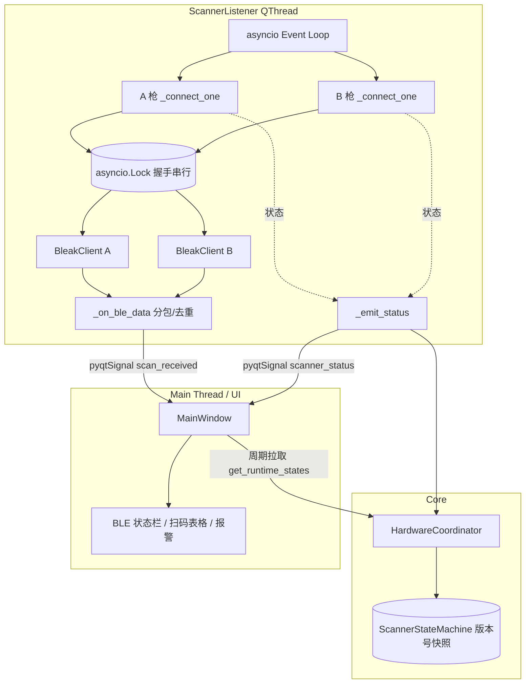

最近做了一个跑在树莓派 3B 上的标签一致性检测系统：85 寸显示屏的泡沫包装面板每垛 15 层，A/B 两面各贴一张标签，要求两面内容完全一致。设备侧的核心动作是两把无线扫码枪同时上线，A 面扫一次、B 面扫一次，软件实时比对，错位就立刻报警。

整套硬件接入里最折腾的，不是协议，也不是业务比对，而是怎么让两把 BLE 扫码枪在车间环境下"长期不掉、掉了能恢复、恢复后还能立刻收得到通知"。这篇就把我在 `bleak` + BlueZ 上踩过的所有坑、对应的实现，按时间线完整梳理一遍，供我自己以后翻、也供后续接手的人少走弯路。

<!-- more -->

## 1. 为什么选 BLE 直连，而不是 HID 模式

扫码枪本身支持 HID 蓝牙键盘模式：配对成功后，系统直接把扫码结果当键盘输入打到当前焦点窗口。这种方式上手最快，但放到这个项目里有几个硬伤：

1. **分不清来源**。两把枪都是键盘事件，没法直接知道这条数据是 A 还是 B，只能靠"输入顺序"猜，遇到漏扫、补扫就乱套。
2. **依赖窗口焦点**。一旦弹出对话框、输入法切换，事件就可能被吞掉。
3. **状态不可观测**。HID 设备的连接状态完全交给系统蓝牙栈管理，应用层只能事后发现"怎么不响了"。
4. **重连不可控**。设备休眠/唤醒后是否自动重连，看系统脸色。

最后的方案是走 BLE GATT 直连：用 `bleak` 主动发现设备，按 MAC 分别和两把枪建立连接，订阅扫码数据的 Notify 特征。这样每条扫码数据都带来源标识进入业务层，连接状态也由我自己掌控。

## 2. 模块拆分

实际项目里 BLE 这块的主要文件就一个 [`hardware/scanner_handler.py`](https://github.com/),它承担了"长连接 + 数据上报 + 状态广播"三件事。再加上几个协作角色：

| 模块 | 职责 |
|------|------|
| `hardware/scanner_handler.py` → `ScannerListener` | BLE 长连接、Notify 订阅、断线重连、状态上报 |
| `core/hardware_coordinator.py` → `HardwareCoordinator` | 全局单例，记录 A/B 枪运行态，仲裁主动探测的冷却时间 |
| `core/hardware_state_machine.py` → `ScannerStateMachine` | 单枪状态机，给状态加版本号，UI 只接受更新号更高的快照 |
| `hardware/hardware_detector.py` → `HardwareDetector` | 启动时和周期性检测硬件健康度，可"非侵入"复用监听器的运行态 |
| `ui/main_window.py` | 实例化 `ScannerListener`，订阅 `scan_received` / `scanner_status` 两个信号 |

`ScannerListener` 继承自 `QThread`，内部跑自己的 asyncio 事件循环，对外用两个 Qt 信号和 UI 通信：

```python
class ScannerListener(QThread):
    scan_received = pyqtSignal(object)        # ScanData
    scanner_status = pyqtSignal(str, str, str)  # scanner_id, state, detail
```

`scan_received` 把扫码结果送到主线程做层号配对和一致性判断；`scanner_status` 把 BLE 连接状态推到 UI，方便操作员看到现场到底连没连上。

UI 这边在主窗口构造完成后就常驻启动监听，不等"开始检测"按钮：

```python
def _ensure_scanner_listener_running(self):
    bt_addr_a = self.config.get('scanner_a_bt_addr', '')
    bt_addr_b = self.config.get('scanner_b_bt_addr', '')

    if self.scanner_thread is None:
        self.scanner_thread = ScannerListener()
        self.scanner_thread.scan_received.connect(self._on_scan_received)
        self.scanner_thread.scanner_status.connect(self._on_scanner_status)
        self.scanner_thread.set_device_mapping(bt_addr_a, bt_addr_b)
        self.scanner_thread.start()
    else:
        self.scanner_thread.set_device_mapping(bt_addr_a, bt_addr_b)
```

之所以"常驻运行"，是因为早期的版本是点了"开始检测"才连接，结果第一垛产品总要等握手十几秒，工人体验非常差。把监听线程做成跟 UI 同生命周期之后，开始按钮按下时连接通常已经就绪。

## 3. 设备发现与映射

A/B 枪的区分方式很直接：在配置里分别填两把枪的 MAC，监听线程在内部维护一张 MAC → `'A' / 'B'` 的映射表。

```python
def set_device_mapping(self, bt_addr_a: str = '', bt_addr_b: str = ''):
    new_map: Dict[str, str] = {}
    mac_a = self._normalize_mac(bt_addr_a)
    mac_b = self._normalize_mac(bt_addr_b)
    if mac_a:
        new_map[mac_a] = 'A'
    if mac_b and mac_b != mac_a:
        new_map[mac_b] = 'B'

    with self._map_lock:
        self._addr_map = new_map
```

事件循环里定期对照"期望映射"和"已有任务"，差异处补连接、多出的取消任务：

```python
async def _listen_loop(self):
    tasks: Dict[str, asyncio.Task] = {}
    if self._discovery_lock is None:
        self._discovery_lock = asyncio.Lock()  # 必须在事件循环线程上创建

    while self._running:
        desired = self._get_addr_map_snapshot()

        for mac in list(tasks.keys()):
            if mac not in desired:
                tasks[mac].cancel()
                tasks.pop(mac, None)

        for mac, scanner_id in desired.items():
            if mac not in tasks or tasks[mac].done():
                tasks[mac] = asyncio.create_task(self._connect_one(mac, scanner_id))

        await asyncio.sleep(0.8)
```

> 这里特别要注意：`asyncio.Lock()` 不能跨事件循环使用。必须懒加载、在事件循环线程内首次进入时创建，否则不同线程引用同一个锁对象会直接抛 RuntimeError。

发现 MAC 用了两条路径，`bleak` 优先，`bluetoothctl` 兜底：

```python
@staticmethod
def list_bt_scanners(timeout: float = 8.0) -> List[BtScannerDevice]:
    devices: List[BtScannerDevice] = []
    if BleakScanner is not None:
        try:
            discovered = asyncio.run(BleakScanner.discover(timeout=timeout))
            ...
        except Exception:
            pass
    if devices:
        return devices

    try:
        out = subprocess.check_output(
            ['bluetoothctl', 'devices'], timeout=5,
            stderr=subprocess.DEVNULL,
        ).decode('utf-8', errors='replace')
        for line in out.splitlines():
            parts = line.strip().split(' ', 2)
            if len(parts) >= 2 and parts[0] == 'Device':
                devices.append(BtScannerDevice(mac=parts[1].upper(),
                                               name=parts[2] if len(parts) > 2 else parts[1]))
    except Exception:
        pass
    return devices
```

`bluetoothctl` 走 `subprocess` 是为了避免 `bleak` 在树莓派上偶发卡死的扫描调用阻塞 UI。

## 4. 单枪连接：握手锁 + 长生命周期

每把枪一个 `_connect_one` 协程，结构是经典的"无限循环 + 握手 + 等待 + 异常 → 退避重连"。但里面有几个不显眼但极关键的细节，先把核心代码贴出来再分项展开：

```python
async def _connect_one(self, mac: str, scanner_id: str):
    reconnect_delay = 1.0
    retry_count = 0
    first_attempt = True

    while self._running:
        cur_map = self._get_addr_map_snapshot()
        if mac not in cur_map or cur_map.get(mac) != scanner_id:
            return

        client = None
        notify_uuid = None
        connected_at = None
        try:
            # === 握手阶段：拿 discovery 互斥锁 ===
            async with self._discovery_lock:
                if first_attempt:
                    first_attempt = False
                    await self._force_bluez_disconnect(mac)

                self._emit_status(scanner_id, 'connecting', mac, retry_count=retry_count)
                target = await self._resolve_connect_target(mac)
                if target is None:
                    raise RuntimeError('扫描未发现目标设备')

                client = BleakClient(target, timeout=10.0)
                await client.connect()
                notify_uuid = await self._find_notify_uuid(client)
                if not notify_uuid:
                    raise RuntimeError('未找到可用 Notify 特征')

                await client.start_notify(
                    notify_uuid,
                    lambda _, data, m=mac: self._on_ble_data(m, data),
                )
            # === 锁已释放，对方可以开始它的握手 ===

            self._emit_status(scanner_id, 'connected',
                              f'{mac} | {notify_uuid}', retry_count=0)
            connected_at = time.monotonic()
            reconnect_delay = 1.0
            retry_count = 0

            while self._running and client.is_connected:
                cur_map = self._get_addr_map_snapshot()
                if mac not in cur_map or cur_map.get(mac) != scanner_id:
                    break
                await asyncio.sleep(0.3)

            self._emit_status(scanner_id, 'disconnected', mac, retry_count=retry_count)

            alive_sec = time.monotonic() - (connected_at or time.monotonic())
            if alive_sec < 3.0:
                reconnect_delay = min(max(reconnect_delay * 1.8, 2.0), 8.0)
                self._emit_status(scanner_id, 'reconnect_backoff',
                                  f'短连，退避重连 {reconnect_delay:.1f}s',
                                  retry_count=retry_count,
                                  backoff_ms=int(reconnect_delay * 1000))
                await asyncio.sleep(reconnect_delay)
            else:
                reconnect_delay = 1.0
        except asyncio.CancelledError:
            return
        except Exception as e:
            is_in_progress = (
                BleakDBusError is not None
                and isinstance(e, BleakDBusError)
                and 'InProgress' in str(e)
            )
            self._emit_status(scanner_id, 'error', str(e), retry_count=retry_count)
            if is_in_progress:
                await asyncio.sleep(0.5)  # InProgress 是瞬态，不计入 retry
            else:
                retry_count += 1
                reconnect_delay = min(max(reconnect_delay * 1.5, 2.0), 8.0)
                await asyncio.sleep(reconnect_delay)
        finally:
            if client is not None:
                try:
                    if notify_uuid and getattr(client, 'is_connected', False):
                        await client.stop_notify(notify_uuid)
                except Exception:
                    pass
                try:
                    if getattr(client, 'is_connected', False):
                        await client.disconnect()
                except Exception:
                    pass
```

下面把每一处"为什么这么写"逐项展开。

## 5. 问题与解决方式（按踩坑顺序）

### 5.1 服务被强杀后，BLE 连接"秒成功但收不到数据"

**现象**：systemd 管理的服务被 `SIGKILL` 重启后，新进程里 `BleakClient.connect()` 立刻返回成功，蓝牙灯也是常亮，但 `start_notify` 之后死活收不到 Notify 回调。

**根因**：BlueZ 内核侧维护着 BLE ACL 连接和 GATT 订阅状态（CCCD）。进程被 `SIGKILL` 时没有机会调用 `disconnect()`，旧连接和旧订阅在 BlueZ 看来仍然有效。新进程握手时设备其实是被旧句柄"占用"的，能完成握手，但 Notify 通道走的是旧订阅，没法触达新进程。

**解决**：每个连接任务在第一次尝试前，强制执行一次 `bluetoothctl disconnect <MAC>` 把残留状态踢掉，并留 0.5s 给 BlueZ 释放：

```python
async def _force_bluez_disconnect(self, mac: str):
    if not mac:
        return
    try:
        await asyncio.get_event_loop().run_in_executor(
            None,
            lambda: subprocess.run(
                ['bluetoothctl', 'disconnect', mac],
                stdout=subprocess.DEVNULL,
                stderr=subprocess.DEVNULL,
                timeout=4,
            ),
        )
        await asyncio.sleep(0.5)
    except Exception:
        pass
```

`run_in_executor` 是为了避免阻塞事件循环；只在 `first_attempt` 时执行一次，之后的重连不再清理，否则连掉线也会被自己干掉。

### 5.2 双枪同时连接报 `org.bluez.Error.InProgress`

**现象**：A 枪连接正常，B 枪几乎同时握手就抛异常：

```
bleak.exc.BleakDBusError: [org.bluez.Error] InProgress
```

而且只要不解决，B 枪进入"永远 InProgress"循环。

**根因**：树莓派 3B 只有一个 HCI 适配器，BlueZ 在单适配器上不支持并发 BLE Discovery。`bleak 0.19.x` 的 `BleakClient.connect()` 内部会隐式触发一次设备发现，A、B 两个任务同时进入握手就一定撞车。

**解决**：用 `asyncio.Lock` 把"resolve 目标 + connect + start_notify"这一段串行化，进入长等待循环之前立刻释放：

```python
async with self._discovery_lock:
    if first_attempt:
        first_attempt = False
        await self._force_bluez_disconnect(mac)
    target = await self._resolve_connect_target(mac)
    client = BleakClient(target, timeout=10.0)
    await client.connect()
    notify_uuid = await self._find_notify_uuid(client)
    await client.start_notify(notify_uuid,
                              lambda _, data, m=mac: self._on_ble_data(m, data))
# 锁释放，另一把枪现在可以开始它的握手
```

锁的范围只覆盖握手，数据接收并不串行，两把枪的 Notify 回调照常并行进入。

另外一个细节：万一仍然偶发 `InProgress`（比如蓝牙栈刚启动），异常分支专门把它当作瞬态处理，固定 0.5s 短退避，且**不递增 retry_count**，避免被误判为持续失败。

### 5.3 设备发现走 `find_device_by_address`，回退裸 MAC

**现象**：早期直接用 MAC 字符串构造 `BleakClient`，遇到某些环境会以"未发现设备"失败；而每次都跑 `BleakScanner.discover()` 又太慢。

**解决**：用 `find_device_by_address` 做一次定向扫描，超时 8 秒；扫到就拿到 `BLEDevice` 对象传给 `BleakClient`，扫不到就回退到 MAC 字符串硬连：

```python
async def _resolve_connect_target(self, mac: str):
    if BleakScanner is None:
        return mac
    try:
        device = await BleakScanner.find_device_by_address(mac, timeout=8.0)
        if device is not None:
            return device
    except Exception:
        pass
    return mac
```

这样既能用上 `bleak` 的 advertising 缓存加速握手，也保留了硬连兜底。

### 5.4 Notify 特征不固定：按优先级匹配，否则取第一个可 Notify

不同厂家的扫码枪，Notify 用的 GATT UUID 不一样。我把现场实际遇到过的几个排了优先级：

```python
NOTIFY_UUIDS_PRIORITY = [
    '0000ffe1-0000-1000-8000-00805f9b34fb',  # HM-10 / AT 串口模块（最常见）
    '6e400003-b5a3-f393-e0a9-e50e24dcca9e',  # Nordic UART Service TX Notify
    '0000fff1-0000-1000-8000-00805f9b34fb',  # 自定义 SPP-like
]

async def _find_notify_uuid(self, client) -> Optional[str]:
    try:
        services = await client.get_services()
    except Exception:
        return None

    found_notify: List[str] = []
    for service in services:
        for char in service.characteristics:
            props = {p.lower() for p in (char.properties or [])}
            if 'notify' in props or 'indicate' in props:
                found_notify.append(str(char.uuid).lower())

    for uuid in NOTIFY_UUIDS_PRIORITY:
        if uuid in found_notify:
            return uuid
    return found_notify[0] if found_notify else None
```

兜底逻辑是"优先表里没命中就拿第一个 notify/indicate 特征"，新型号扫码枪即使没有提前登记 UUID，也能直接跑起来，再回头补到优先级表里。

### 5.5 GATT 通知会分包：缓冲 + 换行切分 + 长度兜底

**现象**：偶尔会收到只有后半段的条码，或者一条扫码被切成两个回调到达。

**根因**：BLE GATT Notification 是按 MTU 分片传输的，一次扫码可能跨多个 `notify` 回调。

**解决**：每把枪维护一个缓冲区，按换行切分成完整行；末尾不是换行的部分留在缓冲区里等下一片：

```python
def _on_ble_data(self, mac: str, data: bytearray):
    scanner_id = self._get_scanner_id(mac)
    if not scanner_id:
        return

    chunk = bytes(data).decode('utf-8', errors='ignore')
    chunk = ''.join(ch for ch in chunk if ch.isprintable() or ch in '\r\n\t')
    if not chunk:
        return

    buf = self._buffers.get(scanner_id, '') + chunk
    lines = re.split(r'[\r\n]+', buf)

    if buf.endswith('\r') or buf.endswith('\n'):
        complete = lines
        remain = ''
    else:
        complete = lines[:-1]
        remain = lines[-1] if lines else ''

    self._buffers[scanner_id] = remain

    for item in complete:
        barcode = item.strip()
        if barcode:
            if self._should_skip_duplicate(scanner_id, barcode):
                continue
            self.scan_received.emit(
                ScanData(scanner_id=scanner_id,
                         barcode=barcode,
                         timestamp=datetime.now())
            )

    # 少数设备根本不发换行，缓冲过长时强制提交，避免条码永远卡在缓冲区
    if len(self._buffers.get(scanner_id, '')) >= 128:
        barcode = self._buffers[scanner_id].strip()
        self._buffers[scanner_id] = ''
        if barcode:
            if self._should_skip_duplicate(scanner_id, barcode):
                return
            self.scan_received.emit(
                ScanData(scanner_id=scanner_id,
                         barcode=barcode,
                         timestamp=datetime.now())
            )
```

两个细节：

1. 在解码后过滤了一遍不可打印字符（保留 `\r\n\t`），是因为有些设备会插入控制字符当作"配置反馈"，会污染条码。
2. 128 字节兜底是给真的不发换行的设备准备的，宁可激进提交，也不要让条码丢在缓冲区里。

### 5.6 同枪同码 300ms 去重

**现象**：少数扫码枪在一次扫描里会重复 Notify 同一条条码，导致同一层被记成两层。

**解决**：维护"上次该枪发出的条码 + 时间戳"，300ms 内同枪同码直接丢弃：

```python
def _should_skip_duplicate(self, scanner_id: str, barcode: str) -> bool:
    now = time.monotonic()
    last = self._last_emit.get(scanner_id)
    self._last_emit[scanner_id] = (barcode, now)
    if not last:
        return False
    last_code, last_ts = last
    return (last_code == barcode) and ((now - last_ts) < 0.3)
```

300ms 这个窗口是经验值：足够挡住 Notify 重复，又不会误伤正常的"故意重扫"。

### 5.7 重连退避：普通失败、短连接、`InProgress` 各自一档

掉线场景有三类，不能用同一种退避：

| 场景 | 处理 | 目的 |
|------|------|------|
| 一次普通的 `connect()` / `start_notify` 异常 | `delay = min(max(delay*1.5, 2.0), 8.0)`，retry_count++ | 避免日志/CPU 风暴 |
| 连接成功但存活 < 3 秒就断开 | `delay = min(max(delay*1.8, 2.0), 8.0)`，更激进退避 | 多半是链路被抢占/设备状态异常，让对方先冷静 |
| `BleakDBusError: InProgress` | 固定 0.5s，不递增 retry_count | 这是瞬态，BlueZ 自己很快就会空闲下来 |

正常长连接（存活 ≥ 3s）一旦断开，重连延迟会被重置为 1.0s，让正常掉线场景可以快速恢复。

### 5.8 finally 里务必 `stop_notify` + `disconnect`

不管是被取消、被异常打断、还是正常断开，都要在 `finally` 里把 `stop_notify` 和 `disconnect` 显式跑一遍：

```python
finally:
    if client is not None:
        try:
            if notify_uuid and getattr(client, 'is_connected', False):
                await client.stop_notify(notify_uuid)
        except Exception:
            pass
        try:
            if getattr(client, 'is_connected', False):
                await client.disconnect()
        except Exception:
            pass
```

否则下一次启动可能又走回第 5.1 节的"假连接"，得再靠 `bluetoothctl disconnect` 救场。

## 6. 跨线程状态同步：信号 + 状态机 + 版本号

`ScannerListener` 是独立 `QThread`，里面跑自己的事件循环。UI 想要实时显示连接状态，就涉及到典型的跨线程问题。

我的做法是**所有状态更新只走一个出口** `_emit_status`：先写本地快照，再交给全局 `HardwareCoordinator`，最后发 Qt 信号。

```python
def _emit_status(self, scanner_id: str, state: str, detail: str,
                 retry_count: int = 0, backoff_ms: int = 0):
    sid = (scanner_id or '').strip().upper()
    if sid not in ('A', 'B'):
        return

    payload = {
        'state': str(state or ''),
        'detail': str(detail or ''),
        'retry_count': max(int(retry_count or 0), 0),
        'backoff_ms': max(int(backoff_ms or 0), 0),
    }

    with self._runtime_lock:
        self._runtime_states[sid] = dict(payload)

    self._coordinator.update_from_listener(
        sid, payload['state'], payload['detail'],
        retry_count=payload['retry_count'],
        backoff_ms=payload['backoff_ms'],
    )
    self.scanner_status.emit(sid, payload['state'], payload['detail'])
```

`HardwareCoordinator` 内部委托给 `ScannerStateMachine`，每次 `apply_event` 都会自增版本号：

```python
@dataclass
class ScannerSnapshot:
    scanner_id: str
    state: str
    detail: str
    retry_count: int
    backoff_ms: int
    updated_at: str
    version: int
```

UI 拉快照时拿到 `version`，可以直接丢弃旧版本（比如周期刷新比信号晚到的情况），避免界面闪烁回旧状态。

UI 端的处理则反过来——为了避免高频调用 `bluetoothctl` 影响树莓派性能，仅在 `disconnected / error / reconnect_backoff` 这种"不稳定状态"时，才用系统侧检查作为兜底：

```python
@pyqtSlot(str, str, str)
def _on_scanner_status(self, scanner_id: str, state: str, detail: str):
    needs_sys_probe = state in ('disconnected', 'error', 'reconnect_backoff')
    sys_connected = self._is_ble_connected_system(scanner_id) if needs_sys_probe else False
    ...
```

这种"应用层状态为主、系统侧探测兜底"的双轨模式，是这个项目里 UI 状态稳定的关键。

## 7. 状态机

为了便于 UI 显示和现场排错，把状态明确化：

```python
class ScannerState(str, Enum):
    IDLE = 'idle'
    CONNECTING = 'connecting'
    CONNECTED = 'connected'
    DISCONNECTED = 'disconnected'
    ERROR = 'error'
    RECONNECT_BACKOFF = 'reconnect_backoff'
```

实际触发时机是这样：

| 状态 | 何时触发 |
|------|---------|
| `idle` | 监听线程起来但还没设备映射，或映射被清空 |
| `connecting` | 进入握手锁后，开始 `resolve + connect` |
| `connected` | `start_notify` 成功 |
| `disconnected` | `client.is_connected` 变 False，跳出等待循环 |
| `error` | 异常分支统一上报 |
| `reconnect_backoff` | 进入退避 sleep 前，把 `backoff_ms` 一并报上去，方便 UI 显示倒计时 |

UI 把这几个状态映射成中文 + 颜色，操作员一眼就能看出 A/B 哪一把不正常。

## 8. 运行架构图



这张图刚好对应实际线程边界：BLE 长连接、握手锁、Notify 解析全部留在 `QThread` 里；状态先经协调器收口，再以信号的形式抵达 UI。UI 既订阅信号，也允许周期性向协调器拉一次最新快照，作为信号丢失时的兜底。

## 9. 经验小结

把这套东西放到车间里跑了一段时间，最有用的几条经验是：

1. **不要相信"connect 成功就一定能收到数据"**。真正能验证连接可用的是收到第一帧 Notify。
2. **BlueZ 的状态比你以为的"粘"得多**。服务异常退出后必须主动清理一次残留，否则就会陷入"假连接"陷阱。
3. **单 HCI 适配器一定要串行化握手**。两路并发握手在 `bleak` + BlueZ 上几乎一定会撞 `InProgress`。
4. **退避策略要分档**。瞬态错误用最短退避、普通错误指数退避、短连接更激进退避，三者兼顾才能既快又稳。
5. **状态机加版本号，UI 永远不会闪回旧状态**。这点在多线程 + 多刷新源的项目里特别值钱。
6. **应用层状态优先，系统侧探测兜底**。频繁 `bluetoothctl` 在树莓派上会拖累性能，仅在不稳定状态下作为补判更现实。

如果你也在做类似的工业现场 BLE 接入，希望这篇能帮你少走一段路。后续要是再遇到新的坑，会继续在这篇文章里补。
